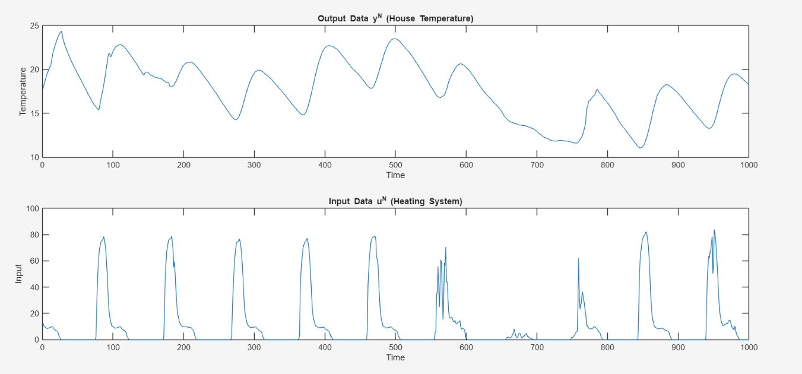
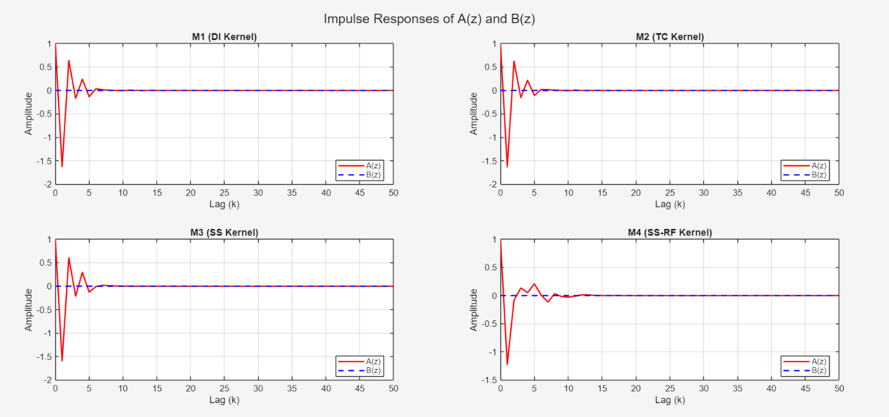
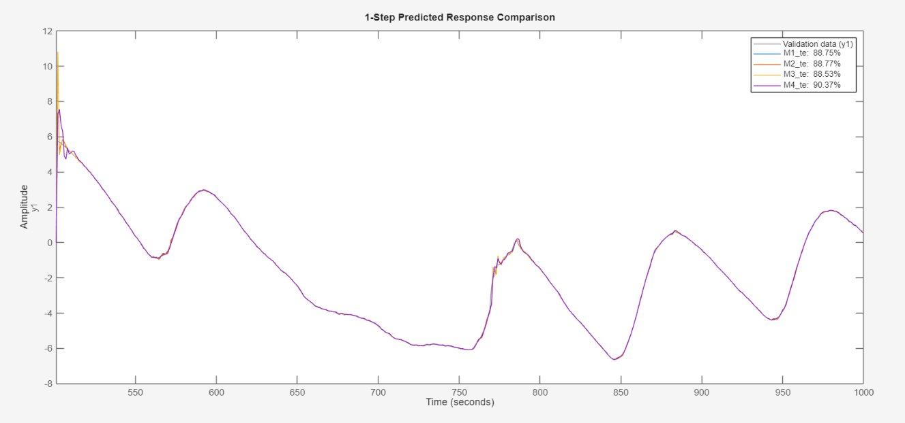
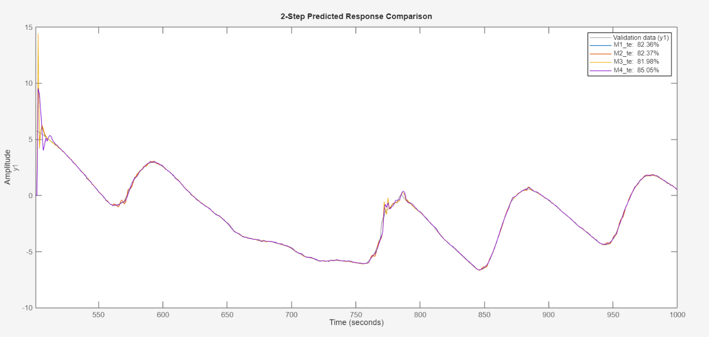
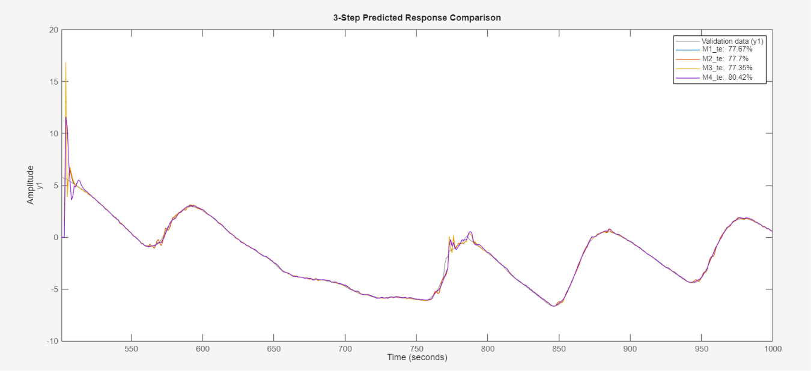
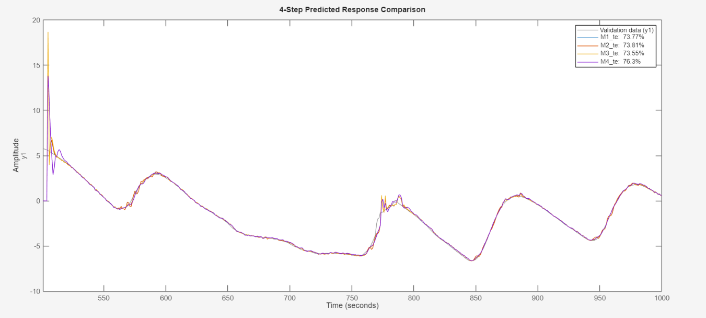
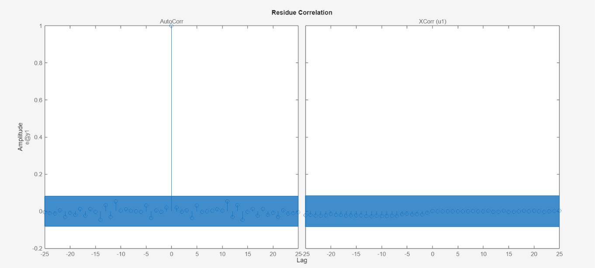
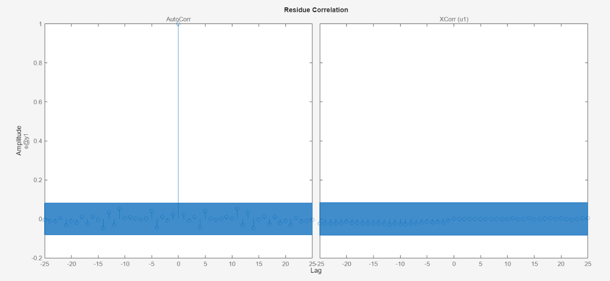
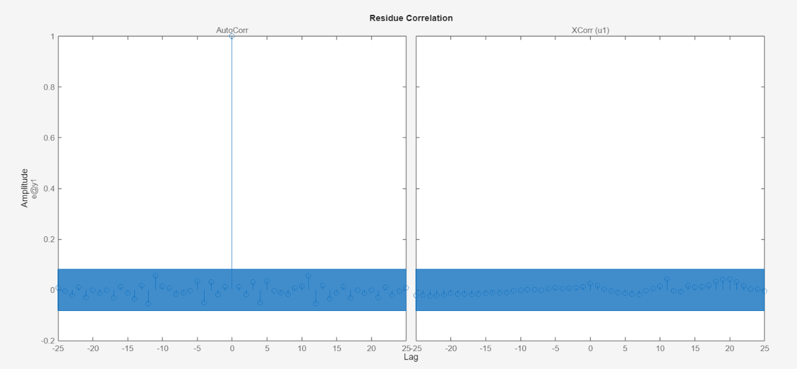
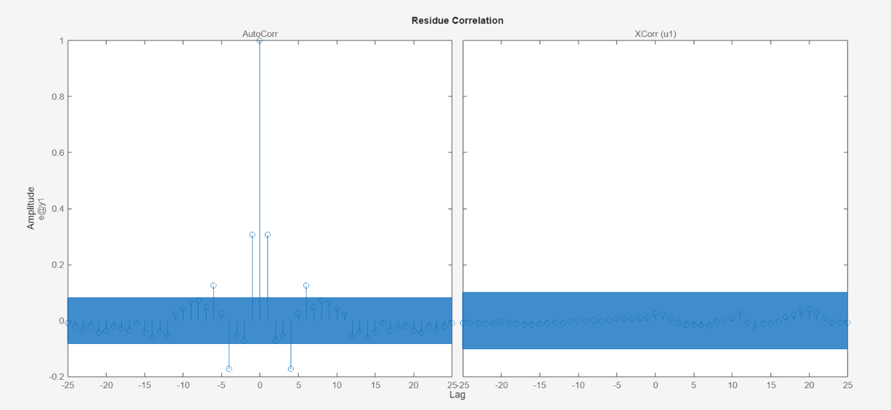

# House Heating System Identification: Kernel-Based ARX & Random Features

## 📌 Project Overview

This repository provides a MATLAB implementation for **dynamic system identification** applied to the thermal modeling of a residential building (*House Heating System*).

The goal of the project is to estimate and compare high-order **kernel-regularized ARX models** ($n_a = 50, n_b = 50, n_k = 1$), evaluating the impact of different regularization kernels and **Random Features** approximations in terms of predictive accuracy, effective model complexity (degrees of freedom), and computational runtime.

---

## 🧠 Mathematical Formulation & Models

Consider a linear discrete-time ARX model structure of high order ($p = 50$):

$$A(z)y(t) = B(z)u(t - 1) + e(t)$$

where:

$$A(z) = 1 + \sum_{k=1}^{n_a} a_k z^{-k}, \qquad B(z) = \sum_{k=0}^{n_b-1} b_k z^{-k}$$

To prevent overfitting on high-order parameter vectors $\theta = [a_1 \dots a_{n_a}, b_0 \dots b_{n_b-1}]^\top$, regularized least squares estimation is performed via Empirical Bayes (Marginal Likelihood maximization):

$$\hat{\theta} = \left( \Phi^\top \Phi + \Lambda R \right)^{-1} \Phi^\top y$$

Starting from the `house.mat` dataset—where $u(t)$ represents the heating system input and $y(t)$ is the indoor house temperature—the signals are detrended and used to identify four distinct regularized ARX model structures:

| Model | Kernel / Method | Description |
| :--- | :--- | :--- |
| **M1** | **DI** (*Diagonal*) | Diagonal kernel enforcing independent exponential decay on the impulse response coefficients. |
| **M2** | **TC** (*Tuned/Correlated*) | Kernel capturing both exponential decay and correlation between adjacent lags. |
| **M3** | **SS** (*Stable Spline*) | Kernel based on stable splines to ensure smoothness and BIBO stability of the impulse response. |
| **M4** | **SS-RF** (*Stable Spline + Random Features*) | Low-rank approximation (`mrand = 5`) of the Stable Spline kernel via Random Features to accelerate hyperparameter optimization. |

---

## 📊 Experimental Results & Visual Analysis

### 1. Raw Dataset (`house.mat`)
Time-series measurements of the indoor house temperature $y^N$ (output) and heating system command $u^N$ (input) sampled at $T_s = 1$.

### 2. Estimated Impulse Responses ($A(z)$ and $B(z)$)
Comparison of the regularized polynomial coefficients across all four kernels (`M1`–`M4`). Notice how **TC**, **SS**, and **SS-RF** enforce smooth decay compared to the uncorrelated **DI** kernel.

### 3. Multi-Step Cross-Validation ($h = 1, 2, 3, 4$)
The dataset is split 50/50 into estimation (`training_data`) and validation (`evaluation_data`) sets. Below is the predictive fit comparison over different prediction horizons $h$:

| 1-Step Ahead ($h = 1$) | 2-Step Ahead ($h = 2$) |
| :---: | :---: |
|  |  |

| 3-Step Ahead ($h = 3$) | 4-Step Ahead ($h = 4$) |
| :---: | :---: |
|  |  |

### 4. Residual Whiteness & Cross-Correlation Analysis
Autocorrelation of residuals $e(t)$ and cross-correlation between input $u(t)$ and residuals $e(t)$ within the 99% confidence bounds:

| M1: DI Kernel | M2: TC Kernel |
| :---: | :---: |
|  |  |

| M3: SS Kernel | M4: SS-RF Kernel |
| :---: | :---: |
|  |  |

### 5. Model Selection & Computational Benchmark

Models are evaluated using **Marginal Likelihood** and **Stein's Unbiased Risk Estimate (SURE)**, which penalizes the training loss $V$ by the effective degrees of freedom $\text{df} = \text{tr}\left(\Phi(\Phi^\top \Phi + \sigma^2 K^{-1})^{-1}\Phi^\top\right)$:

$$\text{SURE} = V \left( 1 + \frac{2\,\text{df}}{N} \right)$$

---

## ⚙️ Analysis Workflow (`main.m`)

1. **Data Loading & Visualization**: Loads `house.mat` ($T_s = 1$) and plots input $u^N$ and output $y^N$.
2. **Preprocessing**: Computes and removes the mean offset via `getTrend` and `detrend`.
3. **Model Estimation**: Optimizes kernel hyperparameters via Marginal Likelihood maximization (`fmincon`) for `M1`, `M2`, `M3`, and `M4`.
4. **Impulse Response Comparison**: Plots estimated $A(z)$ and $B(z)$ polynomial coefficients across all kernels.
5. **Multi-Step Cross-Validation**: Splits the dataset 50/50 and evaluates predictive fit via `compare` over horizons $h = 1, 2, 3, 4$.
6. **Residual Analysis**: Verifies residual whiteness and input-residual independence via `resid`.
7. **Model Selection (SURE & Marginal Likelihood)**: Evaluates `surek` and Marginal Likelihood across all models.
8. **Computational Benchmark**: Measures mean execution time and standard deviation over 20 runs comparing **M3 (SS)** vs. **M4 (SS-RF)**.

---

## 🚀 Requirements & Quickstart

### Tools
- **MATLAB**
- **System Identification Toolbox**
- **Optimization Toolbox**

---

## 🙏 Acknowledgments & Credits

- The kernel regularization routines (`arxRegul.m`, `arxRegulRF2.m`) and the SURE estimator (`surek.m`) are based on implementations by **Mattia Zorzi**.
